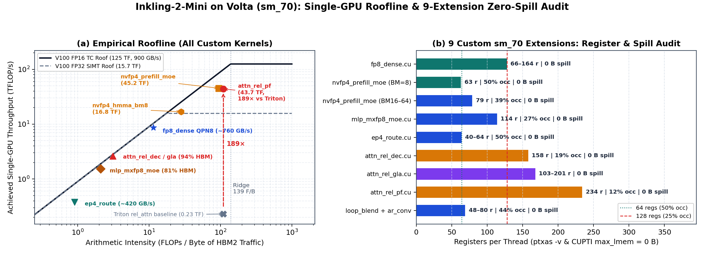

# Inkling-2-Mini on 4× Tesla V100-SXM2 (`inkling_v100`)

`packages/inkling-v100` is a `vllm.general_plugins` package for serving **`thinkingmachines/Inkling-2-Mini`** (`24` physical / `48` logical looped layers, 128-expert top-8 MoE with native NVFP4 `L0–19` and MXFP8 `L20–23`, 20 local SWA-1024 + 4 global sheared relative-bias attention layers, `W=4` short convolutions, FP32 AttnRes, and a native 3-layer **DSpark** 7-token drafter) on 4× Tesla V100-SXM2-16GB (`TP=4/EP=4`, `sm_70`) running unmodified `1Cat-vLLM v1.5.3` / `v1.5.4`.

## Overview

- **12 Zero-Spill `sm_70` CUDA Extensions**:
  - `ep4_moe_fused.cu` (1-launch persistent 80-CTA × 1024-thread `M≤8` EP4 NVFP4 MoE, 64 regs / 0 spills / occupancy 1, `1.7×–5.6×` faster than 4-launch), `nvfp4_prefill_moe.cu` (`BM=8/16/32/64` for `M>8`, exact native NVFP4 with fused softcapped SiTU), `mlp_mxfp8_moe.cu` (exact in-place E8M0 MXFP8 MoE).
  - `fp8_dense.cu` (offline per-channel `absmax` E4M3FN QPN8 dense attention projections + FP32-output `lm_head`, zero-copy Pass-0/Pass-1–2 slices, `KLD=0.0038` vs 48-visit FP32 oracle).
  - `attn_rel_pf_wmma.cu` (3-head-shared WMMA prefill with on-the-fly Tensor-Core `R @ rel_proj`, eliminating `rel_logits` VRAM and accelerating short/local prefill `1.34×–1.47×`), `attn_rel_pf.cu` (`2×8` `HMMA.884` sheared relative-bias prefill fallback), `attn_rel_dec2.cu` (short-SASS 1-launch fused `kv_conv_prologue + decode_attention`, `3.5×–5.7×` faster on local `C=1`, active `C≤8` local / `C≤1` global), `attn_rel_dec.cu` (high-`C` split-KV FP8/FP16 decode/verify, **94% HBM2 peak**), `attn_rel_gla.cu` (opt-in `GLA-g4 r=256` decode/verify/prefill).
  - `ep4_route.cu` (fused top-8 gate + EP4 grouping for `M>8`), `loop_blend.cu` (1-launch cooperative blend for `S*T≤8` + 2-launch multi-token for `S*T>8`), `all_reduce_conv_mix.cu` (1-shot NVLink P2P AllReduce with L2 prefetch, conditional rehearsal, direct post-MoE `[M, H]` path + `W=4` conv + FP32 AttnRes + RMSNorm).
- **Lossless `6.6×–12.1×` KV Capacity + Prefix Caching (`RingConv` + `RingAPC`)**:
  - Under `INKLING_RING_CONV=auto` (default), replaces 6 paged conv KV groups with a fixed 16-slot per-request FP16 ring buffer (`247.5 MiB/GPU`), yielding **`323.0K` Exact FP16 KV tokens (`6.6×` upstream `49.2K` at identical FP16 precision)** and **`594.6K` near-lossless FP8 KV tokens (`12.1×` upstream)** at `util=0.88` (up to `1,042,203` tokens at `util=0.92` / `128K`).
  - **RingAPC** automatically activates when `--enable-prefix-caching` is enabled with `RingConv`: captures bit-exact 3-tap conv checkpoints every `INKLING_RING_APC_STRIDE` tokens (default `512`) into a lazy-allocated pinned host-RAM LRU pool (`1.41 MiB/ckpt`, `0 B` extra GPU KV groups), aligns EngineCore prefix-cache hits & SWA replay windows (`INKLING_RING_APC_RETENTION`, default `4096`) to stride boundaries (with DSpark lookahead awareness), delivering **`0.0` bit-exact diff**, **95–99%** hit rate, and **13×** TTFT speedup at 17.6K context with the full KV pool preserved. Also integrates natively with `--kv-offloading-backend native --kv-offloading-size <GiB>` via zero-copy refcounted GPU↔CPU checkpoint slot aliasing + retention-aligned SWA offload pruning (`~41.3 KB/tok` across 4 GPUs; `64 GiB` RAM adds `524,288` CPU KV blocks ≈ `1.62M` extra cached tokens, verified bit-exact `6.4×` TTFT speedup on live GPU-eviction → RAM reload with automatic LRU discard on RAM overflow).
- **Native DSpark + Shard-Local Probabilistic Verify + Adaptive `K(C)` (`INKLING_SPEC_K="7@1,5@2,3@4"`)**:
  - Mounts `mtp.safetensors` zero-copy with CUDA-graphed draft/context-KV metadata, shard-local recurrent Markov drafting and shard-local greedy/probabilistic target rejection sampling (zero 201K-vocab all-gather for both `T=0` and `T>0`), and `VLLM_USE_SPINLOOP_EXT=1`.
- **Opt-In Composable Global-KV Compression (default OFF)**:
  - `INKLING_GLA_PATH=<safetensors>`: Post-prologue TP4-native `GLA-g4 r=256` (`2×` global KV, **`707.4K`** KV tokens at `util=0.88`, `Top-1=98.28%`, `KLD=0.0083`, `ΔNLL=-0.0089` vs FP32).
  - `INKLING_ELR_GLOBAL_KV=1`: ELR last-loop KV sharing on looped global layers `L11, L17`; combined `GLA-g4 + ELR` reaches **`784.5K` KV tokens (`15.9×` upstream)** and **`1,839 tok/s` at `C=32`** (`Top-1=96.56%`, `KLD=0.0241`, `ΔNLL=+0.0113`).

## Cross-Framework Benchmarks (`4× V100-SXM2-16GB`, `8K–32K` Mixed KV, `util=0.88`)

| Framework / Mode | Agentic `8K–32K` (`S=1 / 2 / 8 / 12 / 16` Out) | Cold Prefill (`1×128 / 4×128 / 1×8K / 1×16K / 1×32K`) | `8K–32K` Steady Decode (`C=1 / 2 / 12 / 24 / 32`) | Served KV Capacity | 48-Visit FP32 Oracle (`ΔNLL / KLD / Top-1`) & Notes |
|---|---:|---:|---:|---:|---|
| `llama.cpp` (`UD-Q4_K_XL`, `-sm layer`) | `6.0 / — / — / — / — tok/s` | `255 / 254 / 275 / 248 / — tok/s` | `8.8 / — / — / — / — tok/s` | `24.6K` (`16.4K` dspark) | Overflows `C≥2`, `S≥2`, and `1×32K` |
| **Upstream `1Cat-vLLM` (`main` `#1616`/`#1625`, `TP4`)** | **`159 / 157`** `/ — / — / — tok/s` | `2,852 / 4,566 /` **`9,735 / 9,371 / 8,987 tok/s`** | **`538 / 383`** `/ — / — / — tok/s` | `49.2K` (`1.5× 32K`) | Exact FP16 KV + 6 paged conv groups + prefix cache + prob. DSpark7; overflows `C≥4`, `S≥4` |
| **`Zeagarden` Exact (`FP16 KV`, `RingConv`)** | `85 / 104 / 158 / 175 / — tok/s` | **`4,190`** `/ 5,717 / 8,763 / 8,563 / 8,151 tok/s` | `419 / 305 / 941 / — / — tok/s` | **`323.0K`** (`6.6×` Up) | **Exact FP16 KV + FP16 dense**; `1.47×` vs Upstream @ `1×128`; scales to `S=12 / C=12` |
| **`Zeagarden` FP8 KV (near-lossless)** | `89 / 108 /` **`164 / 178 / 186 tok/s`** | `3,781 / 5,424 / 8,744 / 8,607 / 8,280 tok/s` | `452 / 273 /` **`969 / 1,612`** `/ — tok/s` | **`594.6K`** (`12.1×` Up) | `+0.0064 / 0.0038 / 97.94%`; `3.0×` Upstream peak @ `C=24` |
| **`Zeagarden` + `GLA-g4 r=256`\* (`≥98%`)** | `84 / 109 / 158 / 166 / 173 tok/s` | `2,257 / 4,625 / 8,398 / 8,139 / 7,690 tok/s` | `415 / 224 / 770 / 1,252 / 1,650 tok/s` | **`707.4K`** (`14.4×` Up) | `-0.0089 / 0.0083 / 98.28%` (`≥98%` Top-1 lossy tier); fits `C=32` |
| **`Zeagarden` + `GLA-g4 + ELR`\* (max KV)** | `85 / 108 / 158 / 167 / 176 tok/s` | `3,758 /` **`6,240`** `/ 8,495 / 8,190 / 7,706 tok/s` | `433 / 264 / 949 / 1,480 /` **`1,839 tok/s`** | **`784.5K`** (`15.9×` Up) | `+0.0113 / 0.0241 / 96.56%`; **`3.4×` Upstream peak @ `C=32`**, **`15.9×` KV** |

## Offline Tools & Configuration Reference

Offline artifact generators under [`packages/inkling-v100/tools/`](../packages/inkling-v100/tools/):
- `prepare_dspark.py --model-dir <ckpt> --out-dir <dir>` — creates the zero-copy DSpark draft directory (`config.json` + symlink to `mtp.safetensors`).
- `quantize_dense_fp8.py --model-dir <ckpt> --out-dir <dir> --mode absmax` — generates offline per-channel E4M3FN dense weights for `INKLING_FP8_DENSE_PATH`.
- `calibrate_gla_g4.py --model-dir <ckpt> --out <file.safetensors> [--fp8-path <fp8>]` — calibrates Post-Prologue `GLA-g4 r=256` (+ shared ELR) projectors for `INKLING_GLA_PATH`.
- `serve_inkling.sh` / `bench_inkling.py` — launch and benchmark helpers.

| Env Var | Default | Description |
|---|---|---|
| `INKLING_V100` | `1` | Master switch (`0` disables plugin registration). |
| `INKLING_FP8_DENSE_PATH` | `""` | Path to offline `absmax` FP8 dense safetensors (`weights/inkling2-mini/inkling2_fp8_dense_absmax.safetensors`; empty = FP16 dense). |
| `INKLING_FP8_TIERS` | `attn,lm_head` | Dense tiers loaded in FP8 (`attn`, `lm_head`, `controllers`). |
| `INKLING_SPEC_K` | `""` | Adaptive DSpark verify width by concurrency (recommended: `7@1,5@2,3@4`). |
| `INKLING_RING_CONV` | `auto` | Lossless per-request ring conv buffer (`auto`/`1` enables `RingConv`, plus `RingAPC` automatically when `--enable-prefix-caching` is on; `0` forces legacy paged conv). |
| `INKLING_RING_APC_STRIDE` | `512` | Token checkpoint stride for `RingAPC` prefix caching (rounded up to a multiple of `lcm_block_size`). |
| `INKLING_RING_APC_RETENTION` | `4096` | SWA replay-window retention interval in tokens for branching prefixes (`0` keeps prompt/reply tail windows only for max multi-session capacity). |
| `INKLING_RING_APC_MAX_SLOTS` | `3072` (`6144` w/ offload) | Max pinned host-RAM conv checkpoints per TP rank for `RingAPC` (lazy-allocated in 64-slot chunks, `1.41 MiB/ckpt`). |
| `INKLING_GLA_PATH` | `""` | Opt-in calibrated `GLA-g4 r=256` projectors (`weights/inkling2-mini/inkling2_gla_g4_r256.safetensors`). |
| `INKLING_ELR_GLOBAL_KV` | `0` | Opt-in ELR last-loop KV sharing on `L11, L17` (`1` enables; composable with `INKLING_GLA_PATH`). |
| `INKLING_V100_EXT_DIR` | `<pkg>/_ext` | Directory for compiled CUDA extensions. |
