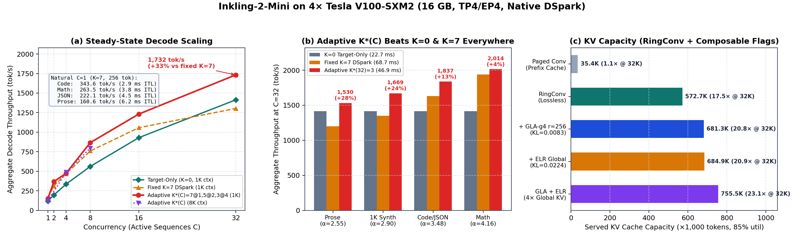

# Inkling-2-Mini on 4× Tesla V100-SXM2 (`inkling_v100`)

`packages/inkling-v100` is a `vllm.general_plugins` package for serving **`thinkingmachines/Inkling-2-Mini`** (`24` physical / `48` logical looped layers, 128-expert top-8 MoE with native NVFP4 `L0–19` and MXFP8 `L20–23`, 20 local SWA-1024 + 4 global sheared relative-bias attention layers, `W=4` short convolutions, FP32 AttnRes, and a native 3-layer **DSpark** 7-token drafter) on 4× Tesla V100-SXM2-16GB (`TP=4/EP=4`, `sm_70`) running unmodified `1Cat-vLLM v1.5.3`.

## Overview

- **9 Zero-Spill `sm_70` CUDA Extensions (`0 B` register spills across all kernels)**:
  - `nvfp4_prefill_moe.cu` (`BM=8` warp-private SMEM for `T=1..256` + `BM=16/32/64` for `T>256`, exact native NVFP4 with fused softcapped SiTU), `mlp_mxfp8_moe.cu` (exact in-place E8M0 MXFP8 MoE).
  - `fp8_dense.cu` (offline per-channel `absmax` E4M3FN QPN8 dense attention projections + FP32-output `lm_head`, zero-copy Pass-0/Pass-1–2 slices, `KL=0.00475` vs 48-visit FP32 oracle).
  - `attn_rel_pf.cu` (`2×8` `HMMA.884` sheared relative-bias prefill, **43.7 TFLOP/s**), `attn_rel_dec.cu` (split-KV FP8 decode/verify, **94% HBM2 peak**), `attn_rel_gla.cu` (opt-in `GLA-g4 r=256` decode/verify/prefill).
  - `ep4_route.cu` (fused top-8 gate + EP4 grouping), `loop_blend.cu` (`gate_rank=64` cross-pass controller blend), `all_reduce_conv_mix.cu` (1-shot NVLink P2P AllReduce + MoE combine + `W=4` conv + FP32 AttnRes + RMSNorm).
- **Lossless `16.2×` KV Capacity (`RingConv`)**:
  - Under `--no-enable-prefix-caching` (default `INKLING_RING_CONV=auto`), replaces paged conv slots with a fixed 16-slot per-request FP16 ring buffer (`247.5 MiB/GPU`), reclaiming the 94% paged conv-state pool tax (`35,435 → 572,709` tokens = `17.5×` concurrent 32K requests, bit-exact).
- **Native DSpark + Adaptive Verify Width (`INKLING_SPEC_K="7@1,5@2,3@4"`)**:
  - Mounts `mtp.safetensors` zero-copy with CUDA-graphed draft/context-KV metadata and TP-local Markov argmax, adapting verify width `K` by active concurrency `C` so speculative decode beats both target-only (`K=0`) and fixed `K=7` across every regime.
- **Opt-In Composable Global-KV Compression (default OFF)**:
  - `INKLING_GLA_PATH=<safetensors>`: Post-prologue TP4-native `GLA-g4 r=256` (`2×` global KV, `KL=0.00825`, `681K` KV tokens).
  - `INKLING_ELR_GLOBAL_KV=1`: ELR last-loop KV sharing on looped global layers `L11, L17` (`2×` global KV, `KL=0.0224`, `685K` KV tokens).
  - Enabled together: `4×` target global KV compression using shared Passes-0/1/2 ELR projectors (**`755,485` KV tokens = `23.1×` @ 32K**, `KL=0.0241`).

## Benchmarks (4× V100-SXM2-16GB, TP4/EP4, FP8 KV, `RingConv`)

| Mode (`ELR`, `GLA`) | Served KV (`32K` Conc.) | Natural `C=1` Code / Math (`K=7`) | `1K C=8 / C=32` Agg (`K=3`) | `8K C=8` / `16K C=8` Agg | Cold TTFT `128 / 4K / 8K` | 48-Visit FP32 KL (`Top-1`) |
|---|---:|---:|---:|---:|---:|---:|
| Target-Only (`K=0`, no DSpark) | `~590K` | `119.5 tok/s` (`8.37 ms`) | `562 / 1,413 tok/s` | `555 / — tok/s` | `87 / 480 / 956 ms` | `0.0038` (`97.9%`) |
| **Lossless `RingConv` `(0, 0)`** | **`572,709` (`17.5×`)** | **`343.6 / 263.5 tok/s`** (`2.9 / 3.8 ms` ITL) | **`877 / 1,694 tok/s`** (`1,732` APC) | **`808 / 1,040 tok/s`** | **`83 / 474 / 947 ms`** | **`0.0038` (`97.9%`)** |
| Opt-in `GLA-g4 r=256` `(0, 1)` | `681,275` (`20.8×`) | `324.0 / 284.8 tok/s` | `885` (`8K`) / `1,538 tok/s` | `885 / 909 tok/s` | `— / 486 / 977 ms` | `0.0083` (`98.3%`) |
| Opt-in `ELR Global` `(1, 0)` | `684,917` (`20.9×`) | `310.4 / 263.7 tok/s` | `— / 1,745 tok/s` | `904 / 977 tok/s` | — | `0.0224` (`98.3%`) |
| Opt-in Combined `(1, 1)` | **`755,485` (`23.1×`)** | `309.7 / 211.1 tok/s` | `712 / 1,633 tok/s` | `863 / 848 tok/s` | `— / 484 / 980 ms` | `0.0241` (`96.6%`) |

## Offline Tools & Configuration Reference

Offline artifact generators under [`packages/inkling-v100/tools/`](../packages/inkling-v100/tools/):
- `prepare_dspark.py --model-dir <ckpt> --out-dir <dir>` — creates the zero-copy DSpark draft directory (`config.json` + symlink to `mtp.safetensors`).
- `quantize_dense_fp8.py --model-dir <ckpt> --out-dir <dir> --mode absmax` — generates offline per-channel E4M3FN dense weights for `INKLING_FP8_DENSE_PATH`.
- `calibrate_gla_g4.py --model-dir <ckpt> --out <file.safetensors> [--fp8-path <fp8>]` — calibrates Post-Prologue `GLA-g4 r=256` (+ shared ELR) projectors for `INKLING_GLA_PATH`.
- `serve_inkling.sh` / `bench_inkling.py` — launch and benchmark helpers.

| Env Var | Default | Description |
|---|---|---|
| `INKLING_V100` | `1` | Master switch (`0` disables plugin registration). |
| `INKLING_FP8_DENSE_PATH` | `""` | Path to offline `absmax` FP8 dense safetensors (`weights/inkling2-mini/inkling2_fp8_dense_absmax.safetensors`; empty = FP16 dense). |
| `INKLING_FP8_TIERS` | `attn,lm_head` | Dense tiers loaded in FP8 (`attn`, `lm_head`, `controllers`). |
| `INKLING_SPEC_K` | `""` | Adaptive DSpark verify width by concurrency (recommended: `7@1,5@2,3@4`). |
| `INKLING_RING_CONV` | `auto` | Lossless per-request ring conv buffer (`auto` enables when prefix caching is off; `0` forces paged). |
| `INKLING_GLA_PATH` | `""` | Opt-in calibrated `GLA-g4 r=256` projectors (`weights/inkling2-mini/inkling2_gla_g4_r256.safetensors`). |
| `INKLING_ELR_GLOBAL_KV` | `0` | Opt-in ELR last-loop KV sharing on `L11, L17` (`1` enables; composable with `INKLING_GLA_PATH`). |
| `INKLING_V100_EXT_DIR` | `<pkg>/_ext` | Directory for compiled CUDA extensions. |
