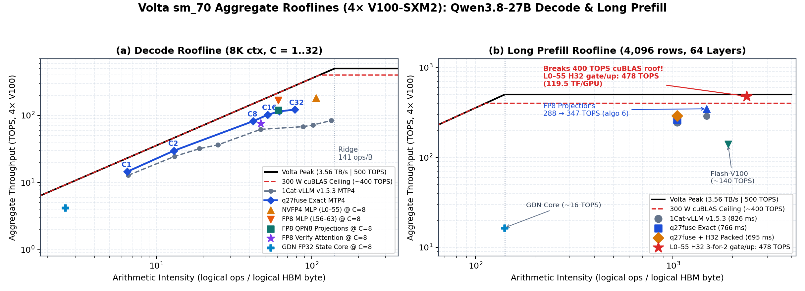

# Qwen3.8-27B-NVFP4 on 4× Tesla V100-SXM2 (`q27fuse`)

`packages/q27fuse` is a `vllm.general_plugins` package for serving **Qwen3.8-27B-NVFP4** (`48` Gated DeltaNet layers + `16` full-attention layers, `56` NVFP4 MLPs + `8` FP8 MLPs) on 4× Tesla V100-SXM2-16GB (`TP=4`, `sm_70`) running unmodified `1Cat-vLLM v1.5.3`.

## Overview

- **Single-Copy `HMMA.884` Decode & MTP Verify (`Q27_FUSE=1`)**:
  - Replaces duplicate weight copies with a single `HMMA.884`-aligned NVFP4 layout (`mlp_fp4.cu`), single-pass QPN8 FP8 projections (`fp8_lin.cu`, `fp8_gdn_in.cu`), and a single-copy FP8 LM head with fused top-1 (`fp8_head.cu`).
  - Fuses GDN decode & MTP deferred-commit verify (`gdn_core.cu`, `gdn_verify.cu`, `gdn_decode.cu`) and split-KV FP8 verify attention (`attn_mq.cu`, `attn_dec.cu`).
  - Screens MTP draft proposals with a Walsh–Hadamard rotated 1-bit sign matrix (`draft_screen.cu`, 40 MB/rank) before exact FP8 rescoring, plus batch-adaptive speculation `Q27_SPEC_K` keeping verify rows `C × (K + 1) ≤ 64`.
- **Exact Short & Long Prefill (`Q27_SPF=1`, default ON)**:
  - Block-flagged device-epoch TP4 reduce-scatter + Gemma norm (`short_arn.cu`, `M = 65..1024`) and direct-register short-M W4/W8 GEMMs (`mlp_short.cu`, `fp8_short.cu`), eliminating vLLM's `2stage` all-reduce cliff on agentic turns.
  - Fused NVLink reduce-scatter + norm (`pf_arn.cu`, `M > 1024`) and cuBLAS `algo 6` FP8 prefill GEMMs (`pf_gemm.cu`).
- **Opt-In Packed Long Prefill (`Q27_PF_PK=1`)**:
  - Online `H_32` Walsh–Hadamard rotation + `INT4 (1, 256)` 3-for-2 mantissa packing + `INT7` activations (`pk_h32.cu`), driving `L0–55 gate/up` to **478 TOPS aggregate** (above Volta's ~400 TOPS 300 W cuBLAS ceiling), protected by a zero-sync device-gated `mod 2^32` Freivalds checksum guard.
- **Opt-In TP4-Native `GLA-g4` KV Compression (`Q27_GLA_CKPT=<path>`)**:
  - Compresses all 16 target full-attention layers and `mtp.layers.0` into 1 shared FP8 latent head per GPU (`256 B/tok` = `2.00×` for `r = 192`, zero cross-GPU replication, zero hybrid-allocator padding layers), spliced directly into QPN8 `qkv_proj` and served by single-read shared-latent `HMMA.884` attention (`attn_gla_mq.cu`).

## Benchmarks (4× V100-SXM2-16GB, TP4, FP8 KV)

| Mode | 8K MTP4 Decode (`C=1 / 8 / 32`) | Short Cold TTFT (`1×64 / 1×128 / 1×256`) | Long Cold TTFT (`1K / 4K / 8K / 8×8K`) | Served KV Capacity | Exactness / Quality |
|---|---:|---:|---:|---:|---|
| `1Cat-vLLM v1.5.3` (no MTP) | `74 / 486 / 1,168 tok/s` | — | — | `688K` (target) | Exact baseline |
| `1Cat-vLLM v1.5.3` (MTP4) | `233 / 1,102 / 1,473 tok/s` | `138 / 132 / 192 ms` | `255 / 902 / 1,799 ms / 14.00 s` | `360,448 tok` | Exact baseline |
| **`q27fuse` Exact (default)** | **`263 / 1,456 / 2,261 tok/s`** (`1.53×`; `2.01×` @ 1K) | **`108 / 112 / 140 ms`** (`79 / 90 ms` target-only) | **`243 / 851 / 1,670 ms / 12.83 s`** | **`420,132 tok`** (`+16.6%`) | 100% greedy exact |
| **`q27fuse` + `H_32` (`Q27_PF_PK=1`)** | `260 / 1,479 / 2,273 tok/s` | Exact `shortpf` (`<512` rows) | **`237 / 803 / 1,549 ms / 11.64 s`** (`1.20×`) | `387,364 tok` (`418,962` zero-plane) | `ΔNLL = +0.0186` (Freivalds guard ON) |
| **`q27fuse` + `GLA-g4` (MTP4)** | `205 / 1,243 / 2,231 tok/s` | `142 / 162 ms` (`128 / 256`) | `244 / 891 / 1,952 ms` | **`671,744 tok`** (`1.86×` 1Cat) | Live `cont ΔNLL = +0.132`, `doc +0.054` |
| **`q27fuse` + `GLA-g4` (Target-Only)** | `8K C=32: 1,776` / `16K: 1,652` / `28K: 1,501 tok/s` | `79.4 / 89.6 ms` (`128 / 256`) | `241 / 773 / 1,737 ms` | **`1,336,934 tok`** (`1.94×` exact) | Serves `896K` live tokens (`28K × 32`) |

## Configuration Reference

| Env Var | Default | Description |
|---|---|---|
| `Q27_FUSE` | `0` | Master switch (`1` enables the plugin; `0` leaves `1Cat-vLLM` untouched). |
| `Q27_SPEC_K` | `""` | Adaptive MTP draft lengths by concurrency (recommended: `4@1,3@2,4@3,3@4,1@16,2@17,1@22`). |
| `Q27_SPF` | `1` | Exact short/agentic prefill kernels (`short_arn`, `mlp_short`, `fp8_short`); `0` disables. |
| `Q27_DS` | `1` | Rotated 1-bit MTP draft screen (`draft_screen.cu`); `0` falls back to stock draft head. |
| `Q27_PF_PK` | `0` | Opt-in packed long-prefill MLP (`1` + `Q27_PF_H32_PLANE=weights/qwen3-27b/h32_planes` or `Q27_PF_H32_NV=1`). |
| `Q27_GLA_CKPT` | `""` | Opt-in TP4-native `GLA-g4` projectors (`weights/qwen3-27b/gla_g4_u192_qo_mtp.safetensors`). Set `Q27_GLA_MTP=0` to keep `mtp.layers.0` uncompressed. |
| `Q27_FUSE_BUILD` | `~/.cache/q27fuse/build` | Directory prefix for compiled CUDA extensions. |

Prebuilt LFS artifacts live under [`weights/qwen3-27b/`](../weights/qwen3-27b/) (`gla_g4_u192_qo_mtp.safetensors`, `h32_planes/h32_planes_r{0..3}.safetensors`). Launch helper: [`packages/q27fuse/tools/serve_q27.sh`](../packages/q27fuse/tools/serve_q27.sh).
