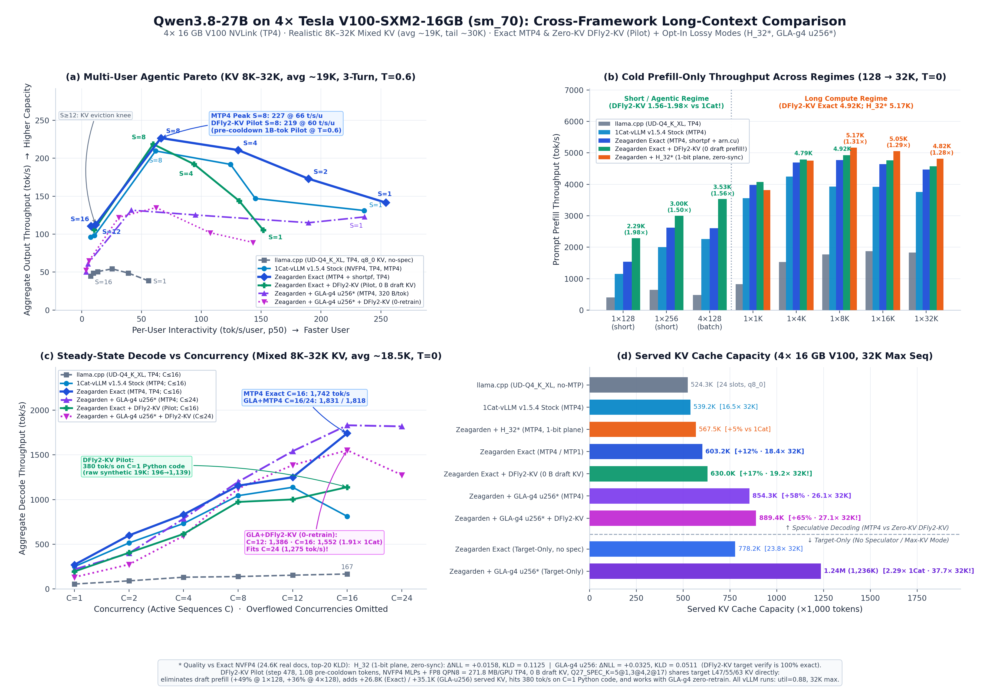

# Qwen3.8-27B-NVFP4 on 4× Tesla V100-SXM2 (`q27fuse`)

`packages/q27fuse` is a `vllm.general_plugins` package for serving **Qwen3.8-27B-NVFP4** (`48` Gated DeltaNet layers + `16` full-attention layers, `56` NVFP4 MLPs + `8` FP8 MLPs) on 4× Tesla V100-SXM2-16GB (`TP=4`, `sm_70`) running unmodified `1Cat-vLLM v1.5.3` / `v1.5.4`.

## Overview

- **Single-Copy `HMMA.884` Decode & MTP Verify (`Q27_FUSE=1`)**:
  - Replaces duplicate weight copies with a single `HMMA.884`-aligned NVFP4 layout (`mlp_fp4.cu`), single-pass QPN8 FP8 projections (`fp8_lin.cu`, `fp8_gdn_in.cu`), and a single-copy FP8 LM head with fused top-1 (`fp8_head.cu`).
  - Fuses GDN decode & MTP deferred-commit verify (`gdn_core.cu`, `gdn_verify.cu`, `gdn_decode.cu`) and split-KV FP8 verify attention (`attn_mq.cu`, `attn_dec.cu`).
  - Screens MTP draft proposals with a Walsh–Hadamard rotated 1-bit sign matrix (`draft_screen.cu`, 40 MB/rank) before exact FP8 rescoring, plus batch-adaptive speculation `Q27_SPEC_K` (`4@1,3@9,1@16,2@17,1@22` on `v1.5.4`).
- **Unified Exact Prefill (`Q27_ARN=1`, `Q27_SPF=1`, default ON)**:
  - Unified CUDA-graph-safe TP4 reduce-scatter + Gemma norm (`arn.cu`, single `45 MiB/rank` IPC pool, `M = 65..4608`, delegating eager `128..1024` sharded-residual prefills to `1Cat v1.5.4`'s zero-VRAM tiled ARN), direct-register short-M W4/W8 GEMMs (`mlp_short.cu`, `fp8_short.cu` covering `M=195` PIECEWISE MTP graphs), and microbench-tuned cuBLAS `algo 6` / `v1.5.4` FP8 prefill cutovers (`pf_gemm.cu`).
- **Opt-In Packed Long Prefill (`Q27_PF_PK=1`)**:
  - Online `H_32` Walsh–Hadamard rotation + `INT4 (1, 256)` 3-for-2 mantissa packing + `INT7` activations (`pk_h32.cu`), with optional BF16-guided 1-bit selection plane (`Q27_PF_H32_PLANE`) and a zero-sync device-gated `mod 2^32` Freivalds checksum guard.
- **Opt-In Zero-KV-Cache `DFly2-KV` Drafter (`Q27_DFLY2_CKPT=<path>`)**:
  - Replaces the single-layer MTP drafter with a 3-layer block-parallel (`γ = 5`, `block_size = 6`) + sequential `AttentiveCorrection` drafter (`dfly2.py`, `dfly2_ops.cu`) reading target post-RoPE KV directly from Q27 layers `[47, 55, 63]` (**`0 B` draft KV**, zero draft prefill pass!).
  - Quantized offline via `packages/q27fuse/tools/quantize_dfly2.py` to `NVFP4-FP8` (`271.8 MB/GPU` TP4, NVFP4 MLPs on `mlp_fp4.cu`/`mlp_short.cu` + FP8 QPN8 projections on `fp8_lin.cu`/`fp8_short.cu`, `cos = 0.9990` / `logits cos = 0.99965` live vs BF16 reference across multi-page KV).
  - Supports FULL CUDA-graph capture per `(B_pad, K)` bucket (`Q27_SPEC_K="5@1,3@4,2@17"`), `draftscreen` top-1 screening, native `K = 5` (`tm = 6`) GDN verify (`gdn_verify.cu`), and **zero-retrain `GLA-g4` compatibility** (`gla_q_absorb` + `attn_gla_mq` LSE + fused `v_up` block merge).
- **Opt-In TP4-Native `GLA-g4` KV Compression (`Q27_GLA_CKPT=<path>`)**:
  - Compresses all 16 target full-attention layers and `mtp.layers.0` into 1 shared FP8 latent head per GPU (`320 B/tok` for `u256`, `256 B/tok` for `u192`, zero cross-GPU replication), spliced directly into QPN8 `qkv_proj` with compressed hybrid Mamba/Attention page alignment (`Platform.update_block_size_for_backend`) and served by single-read shared-latent `HMMA.884` attention (`attn_gla_mq.cu`).

## Cross-Framework Benchmarks (`4× V100-SXM2-16GB`, `8K–32K` Mixed KV, `1Cat-vLLM v1.5.4`)

| Framework / Mode | Agentic `8K–32K` (`S=1 / 2 / 8` Out @ Interactivity) | Cold Prefill (`1×128 / 4×128 / 1×8K / 1×16K / 1×32K`) | `8K–32K` Steady Decode (`C=1 / 8 / 12 / 16 / 24`) | Served KV (`32K` Max Seq) | Quality vs Exact NVFP4 (`24.6K` real docs) |
|---|---:|---:|---:|---:|---|
| `llama.cpp` (`UD-Q4_K_XL`, `TP4`, `q8_0`) | `39 @ 56 / 49 @ 39 / 51 @ 13` | `402 / 477 / 1,768 / 1,877 / 1,834 tok/s` | `55 / 139 / 154 / 167 / — tok/s` | `524K` *(no-MTP)* | Size-matched GGUF (no NVFP4) |
| Stock `1Cat-vLLM v1.5.4` (`NVFP4`, `MTP4`) | `131 @ 236 / 147 @ 145 / 210 @ 62` | `1,153 / 2,259 / 3,929 / 3,923 / 3,755 tok/s` | `251 / 1,043 / 1,137 / 812 / — tok/s` | `539K` (`16.5× 32K`) | Exact NVFP4 (`96.82%` top-1, `KLD=0.0485` vs BF16) |
| **`Zeagarden` Exact (`MTP4`, integrated shortpf)** | **`142 @ 254 / 173 @ 190 / 227 @ 66`** | `1,534 / 2,599 / 4,769 / 4,642 / 4,469 tok/s` | **`271 / 1,155 / 1,250 / 1,742`** `/ — tok/s` | `603K` (`MTP4/MTP1`) / **`778K`** *(Target-Only)* | 100% greedy exact vs NVFP4 |
| **`Zeagarden` Exact + `DFly2-KV` (Pilot, 0-KV)** | `105 @ 152 / 144 @ 132 / 219 @ 60` | **`2,286 / 3,528 / 4,925 / 4,760 / 4,576 tok/s`** | `196 / 973 / 1,002 / 1,139 / — tok/s` *(380 tok/s Python code)* | **`630K`** (`+17%` vs Stock, `19.2× 32K`) | 100% exact verify (`NVFP4-FP8`, `272 MB/GPU`, `0 B` draft KV) |
| **`Zeagarden` + `H_32`\* (1-bit plane, zero-sync)** | *(exact `<1K`)* | *(exact `<1K`)* / **`5,166 / 5,051 / 4,817 tok/s`** (`1.31×`) | *(same as Exact)* | `567K` (`+5%`) | `ΔNLL = +0.0158`, `KLD = 0.1125` |
| **`Zeagarden` + `GLA-g4 u256`\* (`MTP4`)** | `123 @ 236 / 115 @ 190 / 132 @ 41` | `1,391 / 2,826 / 4,322 / 3,689 / 3,120 tok/s` | `219 /` **`1,198 / 1,541 / 1,831 / 1,818 tok/s`** | `854K` (`MTP4`) / **`1.24M`** *(Target-Only)* | `ΔNLL = +0.0325`, `KLD = 0.0511` |
| **`Zeagarden` + `GLA-g4 u256`\* + `DFly2-KV`** | `89 @ 143 / 102 @ 107 / 122 @ 31` | **`2,368`** `/ 3,386 / 4,472 / 3,819 / 3,241 tok/s` | `132 / 1,123 / 1,386 / 1,552 / 1,275 tok/s` | **`889K`** (`+65%` vs Stock, `27.1× 32K`) | Zero-retrain GLA absorption (`ΔNLL = +0.0325`, `KLD = 0.0511`) |

> Note: `DFly2-KV` results above use the **WSD Pilot checkpoint (`step 478`, `1.0B` pre-cooldown tokens)**. Because it shares target KV with zero draft prefill, it sets new Exact cold-prefill records across all 8 regimes (`1.56–1.98×` short prefill vs Stock `1Cat`), adds `+26.8K` (Exact) / `+35.1K` (GLA-u256) served KV, and reaches `380.1 tok/s` on single-user `T=0` Python code generation, while trailing 100B-pretrained `MTP4` on `T=0.6` greedy-draft agentic and synthetic raw completions until a post-cooldown checkpoint is swapped in.

## Configuration Reference

| Env Var | Default | Description |
|---|---|---|
| `Q27_FUSE` | `0` | Master switch (`1` enables the plugin; `0` leaves `1Cat-vLLM` untouched). |
| `Q27_ARN` | `1` | Unified TP4 all-reduce + Gemma norm (`arn.cu`, `M = 65..4608`); `0` falls back to 1Cat. |
| `Q27_SPEC_K` | `""` | Adaptive draft lengths by concurrency (`4@1,3@9,1@16,2@17,1@22` for MTP4; `5@1,3@4,2@17` for DFly2-KV). |
| `Q27_DFLY2_CKPT` | `""` | Opt-in DFly2-KV drafter directory or `.safetensors` (`NVFP4-FP8`, `FP8`, or `BF16`; requires `num_speculative_tokens=5`). |
| `Q27_DFLY2_HEAD` | `auto` | DFly2-KV Stage C top-1 head (`auto` uses `draftscreen` when enabled; `exact` forces `HeadCopy.top1`). |
| `Q27_SPF` | `1` | Exact short/agentic W4/W8 GEMMs (`mlp_short.cu`, `fp8_short.cu`); `0` disables. |
| `Q27_DS` | `1` | Rotated 1-bit draft screen (`draft_screen.cu`); `0` falls back to stock/exact draft head. |
| `Q27_PF_PK` | `0` | Opt-in packed `H_32` long-prefill MLP (`1`, plus optional `Q27_PF_H32_PLANE=weights/qwen3-27b/h32_planes` for 1-bit BF16 plane; unset uses zero-plane). |
| `Q27_GLA_CKPT` | `""` | Opt-in TP4-native `GLA-g4` projectors (`weights/qwen3-27b/gla_g4_u256_qo_mtp.safetensors` or `gla_g4_u192_qo_mtp.safetensors`; zero-retrain compatible with `Q27_DFLY2_CKPT`). |
| `Q27_FUSE_BUILD` | `~/.cache/q27fuse/build` | Directory prefix for compiled CUDA extensions. |

Prebuilt LFS artifacts live under [`weights/qwen3-27b/`](../weights/qwen3-27b/) (`gla_g4_u256_qo_mtp.safetensors`, `gla_g4_u192_qo_mtp.safetensors`, `h32_planes/h32_planes_r{0..3}.safetensors`). Launch helper: [`packages/q27fuse/tools/serve_q27.sh`](../packages/q27fuse/tools/serve_q27.sh).
